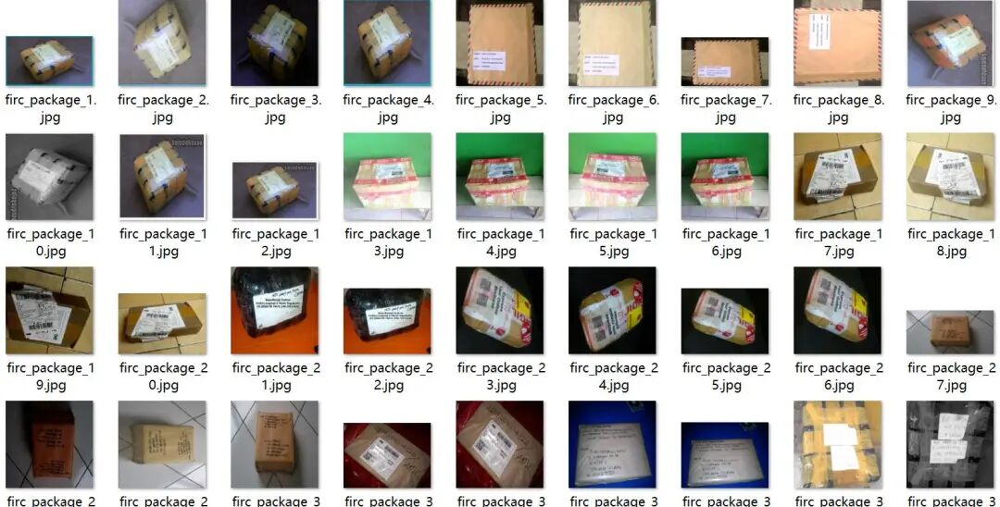
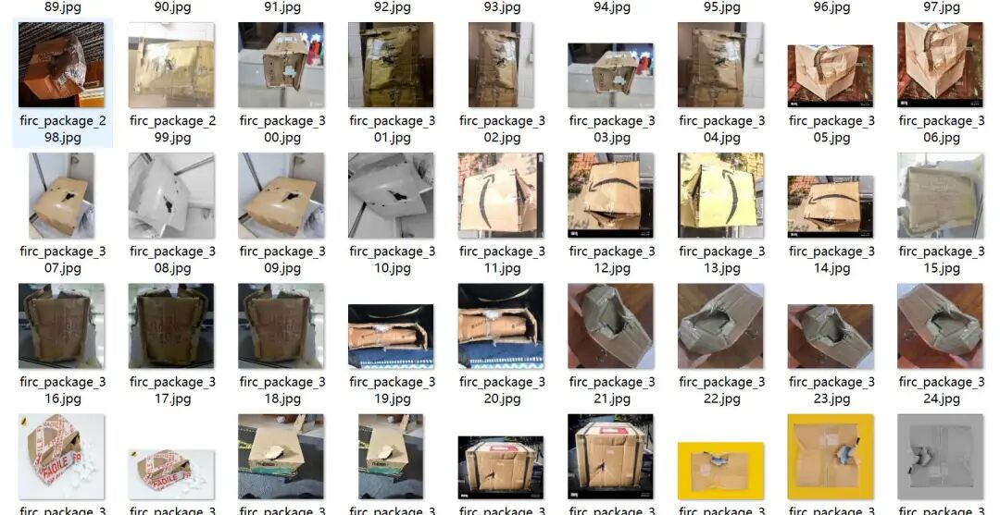
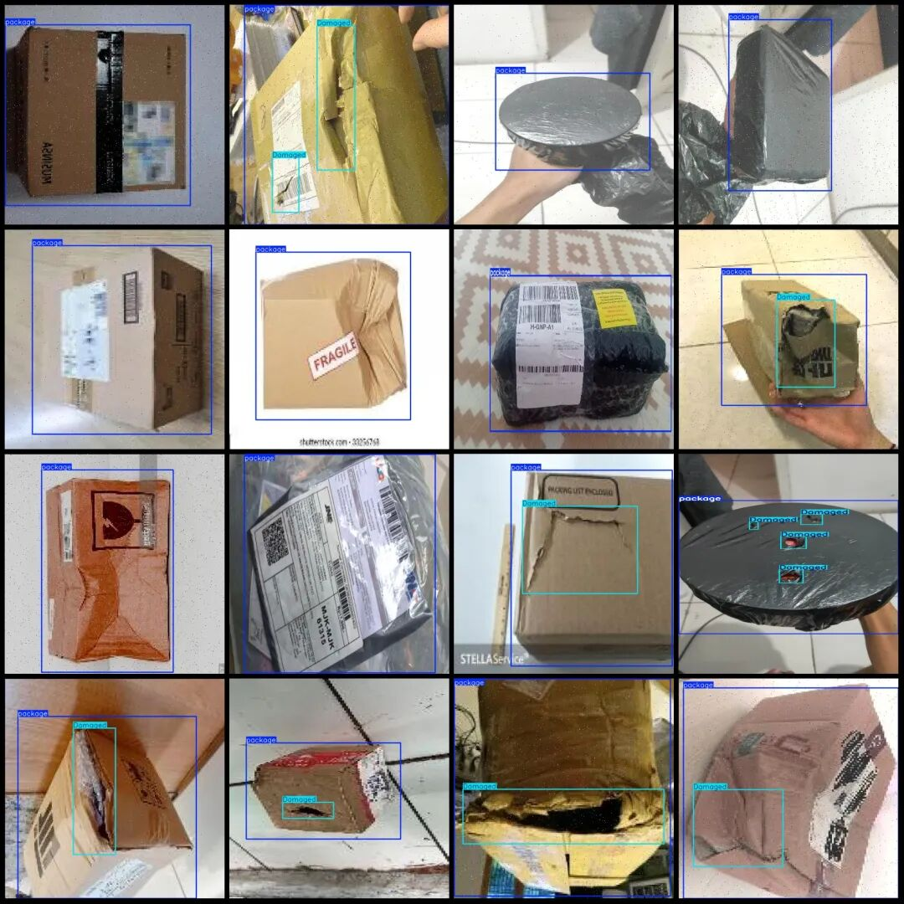
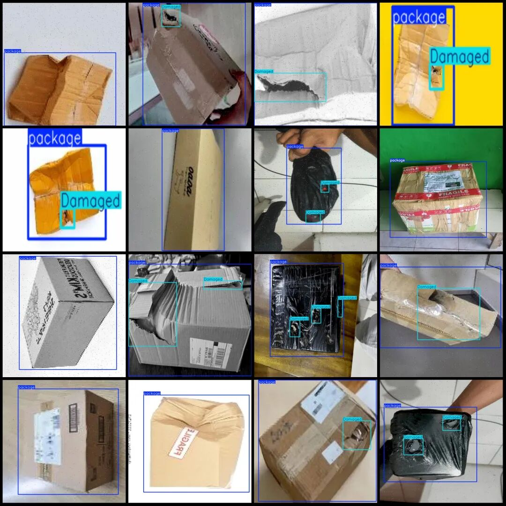

# Intelligent Logistics Express Parcel Damage Detection Dataset VOC+YOLO format with 1340 images in 2 categories

Please note that approximately 500 images in the dataset are original and the remaining are enhanced. Please refer to the image preview for specific details.

Dataset format: Pascal VOC format + YOLO format (txt file without split path, only contains jpg images and corresponding VOC format xml files and yolo format txt files)

Number of images (number of jpg files): 1340

Number of annotations (number of xml files): 1340

Number of annotations (number of txt files): 1340

Labeling category count: 2

Label category names (Note that the order of categories in the YOLO format does not correspond to this, but is based on the labels folder's classes.txt): ["Damaged", "package"]

Number of boxes labeled in each category:

Damaged Frame Count = 1290

Package Frames = 1348

Total frame count: 2638

Number of images per category:

Damaged Number of images held = 798

Package occupancy image count = 1340

Image resolution: Multi-resolution images, such as 150x200, 640x640, etc.

Using labelImg:

Annotation rules: Draw a rectangle around the category.

Important Notice: The dataset does not have separate training, validation, and test sets; you need to partition them yourself.

Special : This dataset does not guarantee the accuracy of the trained models or weight files.

Image Preview:

Annotation example:

## Payment

Here is a pay link on Stripe ( https://buy.stripe.com/3cs8yP7sY87d0vu9AB ). Please contact me lonlonago@foxmail.com after funding $89, and I will send you a complete data files , thank you!

